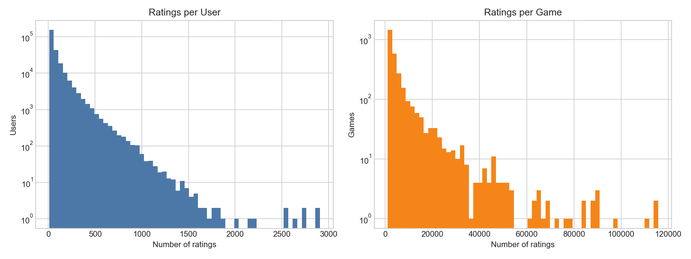
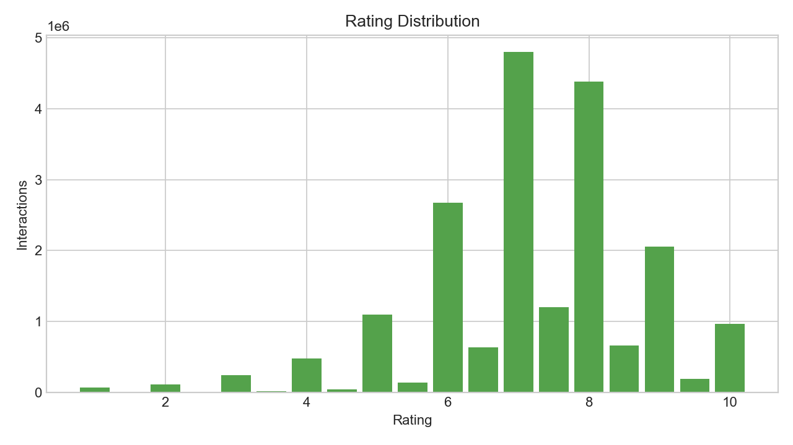
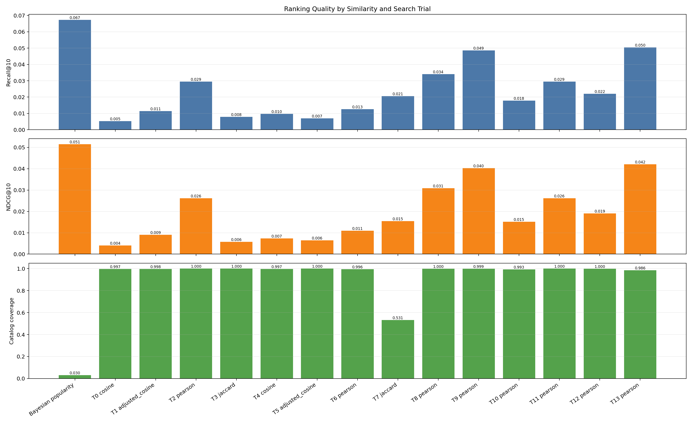
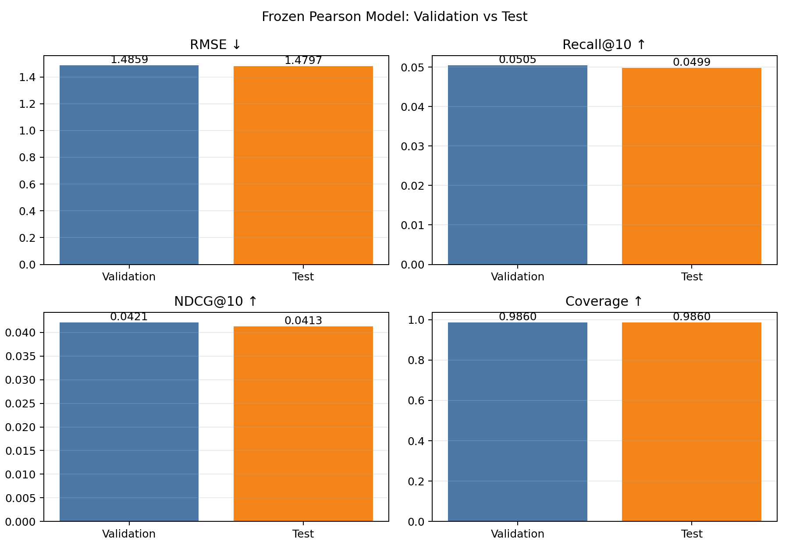
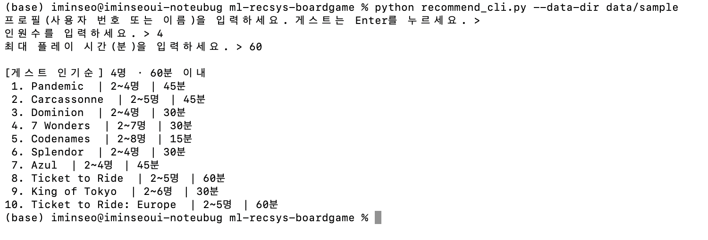
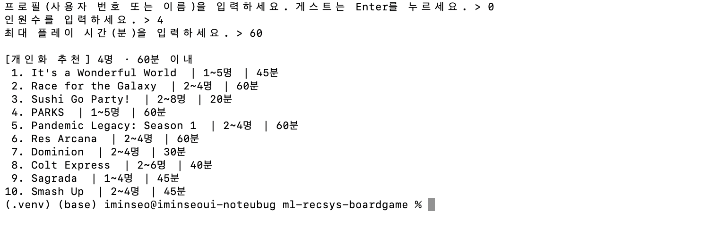

# Board Game Recommendation System

This machine learning project builds personalized board game recommendations from BoardGameGeek (BGG) user ratings.

## Dataset Selection

This project uses the **2025 snapshot** of
`jvanelteren/boardgamegeek-reviews`.

- 26,200,012 raw user-game ratings
- 27,780 game metadata rows
- Metadata including player count, playtime, complexity, categories, and mechanics
- Suitable for comparing collaborative filtering and content-based recommendation on the same dataset

The archive is pinned by dataset version and checksum. Older data was removed
after the current outputs were verified; all preprocessing and model results
use the 2025 snapshot only. The official BGG rank CSV contains only aggregated
game-level scores and cannot replace the user-game interactions required for
personalized recommendations.

The original source is the [BoardGameGeek XML API](https://boardgamegeek.com/wiki/page/XML%20API), and the redistributed dataset is available through [Kaggle BoardGameGeek Reviews](https://www.kaggle.com/datasets/jvanelteren/boardgamegeek-reviews). The BGG API terms should be reviewed before using the data.

## Preprocessing

The raw dataset contains **26,200,012 ratings**. Preprocessing resolves
duplicate/conflicting user-game pairs on disk, joins the 2025 metadata, and
builds a deterministic common evaluation cohort.

| Raw data | Criterion | Processing |
| --- | --- | --- |
| Missing user or game IDs and invalid ratings | Valid BGG ratings range from 1 to 10 | Removed 12 invalid rows; decimal ratings remain unchanged |
| Exact duplicate or conflicting user-game rows | Keep one exact duplicate; reject a pair with different ratings | No duplicates or conflicting pairs were present in this snapshot |
| Missing metadata or too little training support | Use metadata-backed games with at least 100 provisional training ratings | Selected the 3,000 most-rated eligible games using train-only counts |
| Users with insufficient training history | Retain enough history for preference learning | Kept users with at least 10 training ratings |
| Raw IDs are strings with large value ranges | Standardize model inputs | Encoded user and game IDs as zero-based integers |
| Ranking users need a hidden liked game | Preserve at least one 8+ game in every split | Deterministic user-aware train/validation/test split with seed 42 |

The final processed dataset contains **248,457 users, 3,000 games, and
19,745,913 interactions**: 15,473,315 train, 2,138,126 validation, and
2,134,472 test. It has **97.35% sparsity** and 246,319 common ranking users.

```bash
.venv/bin/python -m src.data.download --dataset-version 4
unzip -j data/raw/boardgamegeek-reviews.zip \
  bgg-26m-reviews.csv games_detailed_info2025.csv -d data/raw
.venv/bin/python -m src.data.preprocess
```

### Assignment experiment subset

The original processed dataset is preserved. A smaller experiment dataset is
selected using **training-split statistics only** to avoid validation/test
leakage:

- 2,000 games with the most training ratings
- users with at least 20 training ratings inside that catalog
- 20,000 users sampled proportionally from activity groups `20-39`, `40-79`,
  and `80+`
- compact zero-based IDs written separately under `data/experiment/`

```bash
.venv/bin/python -m src.data.create_experiment_subset \
  --processed-dir data/processed \
  --output-dir data/experiment \
  --max-items 2000 --max-users 20000 \
  --min-user-train-ratings 20 --seed 42
```

The generated experiment subset contains **2,029,222 interactions**: 1,599,055 train,
215,504 validation, and 214,663 test interactions. It has 20,000 evaluation
users, 2,000 games, and 94.93% matrix sparsity. Generated CSV files remain
excluded from Git; the selection code, report schema, and reproduction command
are versioned.

### Team handoff files

The train-only Bayesian ranking is generated with the same 20,000-user ×
2,000-game experiment scope:

```bash
.venv/bin/python -m src.models.popularity
```

This writes `data/experiment/popularity.csv` with rank, game ID, train rating
count, mean rating, and Bayesian score. A small, versioned integration sample is
available under `data/sample/`; its [README](data/sample/README.md) records the
selection rules, file schema, counts, and reproduction commands.





## Project Structure

```text
data/                     Local datasets (excluded from Git)
reports/                  Model reports, metrics, and figures
src/data/                 Download, preprocessing, loading, and EDA
src/models/               Popularity, ItemCF, Matrix Factorization, and content models
src/experiments/          Search, evaluation, outputs, and final tests
src/metrics.py            Metrics shared by every model
tests/                    Regression and model tests
```

## Implemented Models

1. Bayesian popularity baseline using training ratings only.
2. Item-item collaborative filtering with four similarity definitions.
3. Matrix Factorization trained with mini-batch gradient descent.
4. Content-based recommendations using description TF-IDF, categories, and mechanics.
5. Common comparison using RMSE, Recall@10, NDCG@10, and coverage.

## Item-Item Collaborative Filtering Experiment

The first personalized model compares four methods from the recommendation
lecture: cosine, adjusted cosine, Pearson-style correlation, and Jaccard
similarity. It also includes a Bayesian popularity control.

```bash
# Tune on the 20,000-user train/validation data. Test remains untouched.
.venv/bin/python -m src.experiments.item_cf_experiment

# Run only after freezing the validation winner. This evaluates the held-out
# test split without performing any additional parameter search.
.venv/bin/python -m src.experiments.final_item_cf_test
```

The experiment first performs a seeded random search, then refines the random
winner with a small local grid over neighboring K, minimum-support, and
shrinkage values. The search chooses the highest validation NDCG@10, with Recall@10 and catalog
coverage as secondary criteria. RMSE is reported separately because a model can
predict ratings accurately without placing the right unseen games near the top.
The checked-in experiment evaluates all 20,000 selected users.

Concepts beyond the basic lecture formula are commented directly in the code:

- **Adjusted cosine** removes each user's average rating before comparing games.
- **Shrinkage** discounts similarities supported by very few common raters.
- **Baseline-residual scoring** combines deviations from a user's usual rating
  rather than averaging raw ratings from strict and generous users together.
- **Train/validation separation** prevents selecting parameters using the final
  test set. The test split is intentionally not accepted by the search command.

### Reduced-dataset validation results

The 20,000-user experiment evaluated 8 balanced random-search configurations
and 6 local-grid refinements. These validation results were used to freeze the
final configuration before opening the test split.

| Model / best similarity | Rating error (RMSE) ↓ | Liked-game hit rate (Recall@10) ↑ | Ranking quality (NDCG@10) ↑ | Game diversity (Coverage) ↑ |
| --- | ---: | ---: | ---: | ---: |
| Bayesian popularity | 1.3892 | **0.0673** | **0.0515** | 0.0300 |
| Cosine | 1.3278 | 0.0097 | 0.0074 | 0.9965 |
| Adjusted cosine | **1.2506** | 0.0115 | 0.0090 | **0.9975** |
| Pearson | 1.4859 | 0.0505 | 0.0421 | 0.9860 |
| Jaccard | 1.3184 | 0.0206 | 0.0155 | 0.5315 |

Pearson is the current ItemCF ranking winner with 20 neighbors, minimum overlap
3, no shrinkage, and baseline-residual scoring. Bayesian popularity still has
the best validation NDCG@10 overall, while adjusted cosine has the lowest RMSE.
This disagreement illustrates why rating error alone is not sufficient for
evaluating Top-10 recommendation quality.




### Final held-out test result

The frozen Pearson winner was then evaluated once on the 214,663 held-out test
interactions. No parameter was selected or changed using the test result.

| Split | Rating error (RMSE) ↓ | Liked-game hit rate (Recall@10) ↑ | Ranking quality (NDCG@10) ↑ | Game diversity (Coverage) ↑ |
| --- | ---: | ---: | ---: | ---: |
| Validation | 1.4859 | 0.0505 | 0.0421 | 0.9860 |
| **Test (final)** | **1.4797** | **0.0499** | **0.0413** | **0.9860** |

The test result remains close to validation: RMSE improved slightly, while
Recall@10 and NDCG@10 decreased slightly. The small gaps indicate that the
selected configuration generalizes stably to unseen interactions rather than
depending on a lucky validation split. The final report is stored in
`reports/item_cf/final_test_summary.md`.



## Matrix Factorization Experiment

The second personalized model represents every user and game with a learned
latent-factor embedding.  Global, user, and game biases capture broad rating
tendencies; the embedding dot product captures the remaining preference match.

```bash
# Tune only on train + validation. The test file is not accepted here.
.venv/bin/python -m src.experiments.matrix_factorization_experiment

# Evaluate the frozen validation winner once on held-out test data.
.venv/bin/python -m src.experiments.final_matrix_factorization_test
```

The deterministic random search compares latent factors, learning rate,
regularization, and epochs. The winner is selected by validation NDCG@10, with
Recall@10 and RMSE as tie breakers. The frozen 32-factor, learning-rate 0.02,
regularization 0.01, 18-epoch winner achieved validation/test NDCG@10 of
0.0201/0.0197 and RMSE of 1.2518/1.2512. Reproducible outputs are written to
`reports/matrix_factorization/`.

## Content-Based Experiment

The third personalized model represents each game with description TF-IDF and
category/mechanic tags. A user's profile is the normalized weighted average of
games rated at least 8, and cosine similarity ranks unseen games.

```bash
# Compare description vocabulary size and description/tag weights on validation.
.venv/bin/python -m src.experiments.content_based_experiment --mode tune

# Evaluate the frozen winner once and export each user's Top-100 content scores.
.venv/bin/python -m src.experiments.content_based_experiment --mode final
```

The validation winner uses 4,000 description terms, 271 tag features, and equal
description/tag weight. It achieved validation/test NDCG@10 of 0.0349/0.0352,
Recall@10 of 0.0431/0.0438, RMSE of 1.3291/1.3258, and Coverage of 0.8155 on
both splits. The compact handoff file contains the Top 100 scored unseen games
per user at `data/experiment/content_scores.csv`; reproducible reports are in
`reports/content_based/`.
## Hybrid Recommender and Terminal Program

### Method

The hybrid model combines Item-Item CF and the content-based model for one user at a
time and returns a Top 10:

`hybrid(u, i) = w * ItemCF_norm(u, i) + (1 - w) * content_norm(u, i)`

`w` is the weight given to ItemCF. Both scores are min-max normalized to 0-1 per user
(games already rated in train are excluded) and then mixed. Games for which ItemCF finds
no similar-game evidence get an ItemCF score of 0: `score_user` in `item_cf.py` falls
back to popularity, but the hybrid does not treat that as a collaborative-filtering
score. Ties are broken by the smaller game ID.

The hypothesis is that ItemCF (rating patterns) and content-based (game descriptions
and features) use different information, so combining them may beat either alone.

### Choosing w

`w` is chosen from {0.25, 0.50, 0.75} by validation NDCG@10. The test split is used
once, after the choice.

| w (ItemCF weight) | Validation NDCG@10 |
| ---: | ---: |
| **0.25** | **0.0464** |
| 0.50 | 0.0435 |
| 0.75 | 0.0379 |

The selected value is `w = 0.25`. Validation NDCG@10 dropped as `w` grew (more ItemCF
weight). The gap between 0.25 and 0.50 is 0.0029.

### Setup

Final results use `data/experiment` (20,000 users, 2,000 games, 1,599,055 train
ratings); the test users are the 20,000 users in `eval_users.csv`.

| Model | Setting |
| --- | --- |
| ItemCF | Pearson, 20 neighbors, min_overlap 3, shrinkage 0.0, min_similarity 0.0, positive_threshold 8.0, baseline_residual |
| Content-based | max_description_features 4000, min_document_frequency 2, description_weight 0.5, liked_threshold 8.0, rating_scale 2.0 |
| Matrix Factorization | factors 32, lr 0.02, reg 0.01, epochs 18, batch 4096, seed 42, ratings 1-10 |
| Hybrid | `w` in {0.25, 0.50, 0.75}, chosen by validation NDCG@10 |

### Results

Test NDCG@10 on the 20,000-user experiment data:

| Model | Test NDCG@10 |
| --- | ---: |
| **Hybrid (w = 0.25)** | **0.0463** |
| ItemCF | 0.0413 |
| Content-based | 0.0352 |
| Matrix Factorization | 0.0197 |

The hybrid is the highest of these four models. It is 0.0050 above ItemCF and 0.0111
above content-based. The differences are small, were measured in a single run without
a significance test, and may be due to chance. One possible reason for the gain is that
ItemCF and content-based use different information and complement each other; this was
not tested directly.

### Commands

```bash
# Writes outputs/top10_test.csv (model,user_id,item_id,rank for item_cf, mf, content,
# hybrid; before any player/time filter) and outputs/scores.csv (hybrid scores).
.venv/bin/python make_top10.py --data-dir data/experiment

# Terminal recommender: profile (user ID, name, or Enter for guest) -> players -> max minutes.
.venv/bin/python recommend_cli.py --data-dir data/sample --scores outputs/scores.csv
```

MF scores are clipped to 1-10, so many games tie at the maximum. The MF rows of
`top10_test.csv` use the same ranking function as the MF evaluation (`_top_items`), so
the MF test NDCG@10 matches the team result (0.0197). The `scores.csv` for
`data/experiment` is about 760 MB and is not committed; regenerate it with the first
command.

### Terminal program

`recommend_cli.py` asks for a profile, the number of players and the maximum playtime,
then prints 10 matching games.

- **Filter:** keeps games with `condition_eligible` and `is_valid` true, whose player
  range includes the given number, and whose `max_playtime` is at most the given
  minutes (the playtime rule is our own assumption).
- **Guest (Enter at the profile prompt):** games ranked by the number of train ratings.
- **Profile:** hybrid scores from `scores.csv`, excluding games the user already rated
  in train. Profiles with no train history or no scores fall back to the guest mode
  with a notice.
  
Guest (Enter at the profile prompt), 4 players, 60 minutes:



Profile 0 (personalized), 4 players, 60 minutes:



### Reference

- [Weighted hybridization](https://apxml.com/courses/building-ml-recommendation-system/chapter-6-constructing-a-hybrid-recommendation-system/weighted-hybridization).
  The `alpha` in that article weights the content side, so its direction is opposite to
  `w` here.
