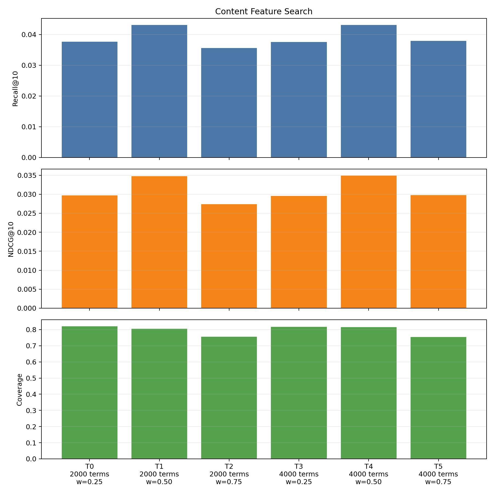
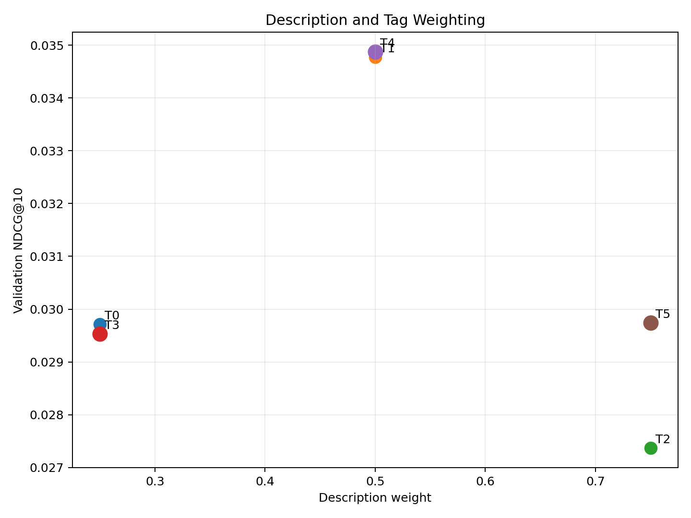
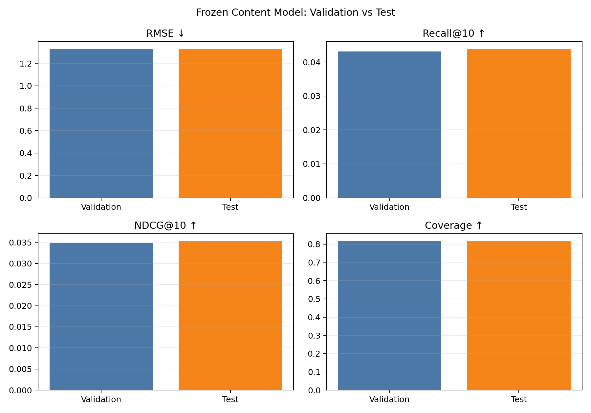

# Content-based experiment

The model builds a profile from games a user rated at least 8 in training. It recommends unseen games with similar descriptions, categories and mechanics.

## Features and selected settings

Description text is cleaned and converted to TF-IDF. Categories and mechanics are separate multi-hot features. Each feature block is L2-normalized, weighted, joined and normalized again. A liked rating r contributes profile weight r - 8 + 1. Training-rated games are excluded.

The six validation configurations combined 2,000 or 4,000 description features with description weights 0.25, 0.50 or 0.75.

| Parameter | Selected value |
| --- | ---: |
| Description features | 4,000 |
| Category and mechanic features | 271 |
| Minimum document frequency | 2 |
| Description weight | 0.50 |
| Tag weight | 0.50 |
| Liked rating threshold | 8 |
| Rating conversion scale | 2.0 |

The selected configuration had the highest validation NDCG@10. It used equal weights for description and tag blocks.

## Final test

| Split | RMSE | Recall@10 | NDCG@10 | Coverage |
| --- | ---: | ---: | ---: | ---: |
| Validation | 1.3291 | 0.0431 | 0.0349 | 0.8155 |
| Test | 1.3258 | 0.0438 | 0.0352 | 0.8155 |

The experiment uses the common 20,000-user, 2,000-game data. On the test split, Recall@10 and NDCG@10 were below ItemCF and above matrix factorization.

## Score export

data/experiment/content_scores.csv stores the top 100 unseen content scores for each user, for 2,000,000 rows. The columns are user_id, item_id, rank and content_score. Scores are cosine similarities. The --export-top-k option changes the saved list length.

## Files and commands

    .venv/bin/python -m src.experiments.content_based_experiment --mode tune
    .venv/bin/python -m src.experiments.content_based_experiment --mode final

- content_trials.csv lists the six settings and validation metrics.
- best_content.json stores the selected settings.
- final_test_metrics.json stores the final test measurements.
- ranking_metrics.png shows the search results.
- feature_weight_effects.png compares feature weights.
- validation_vs_test.png compares both splits.
