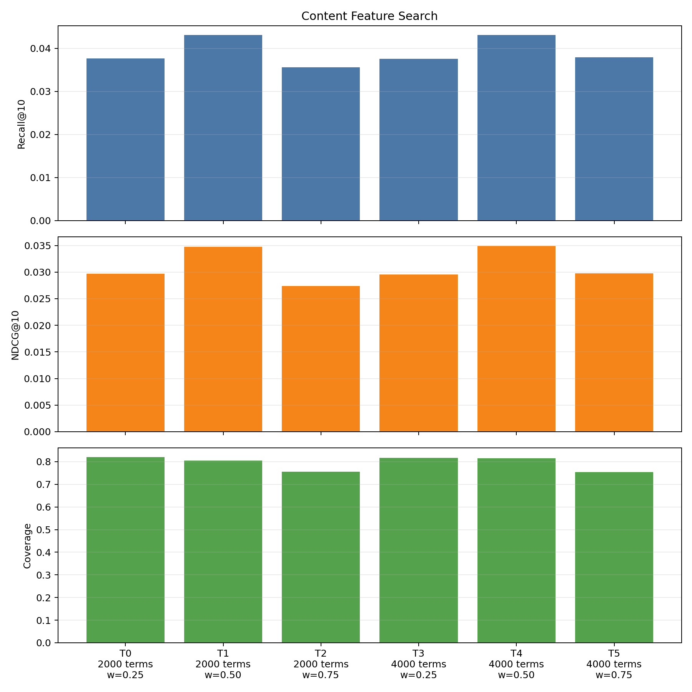
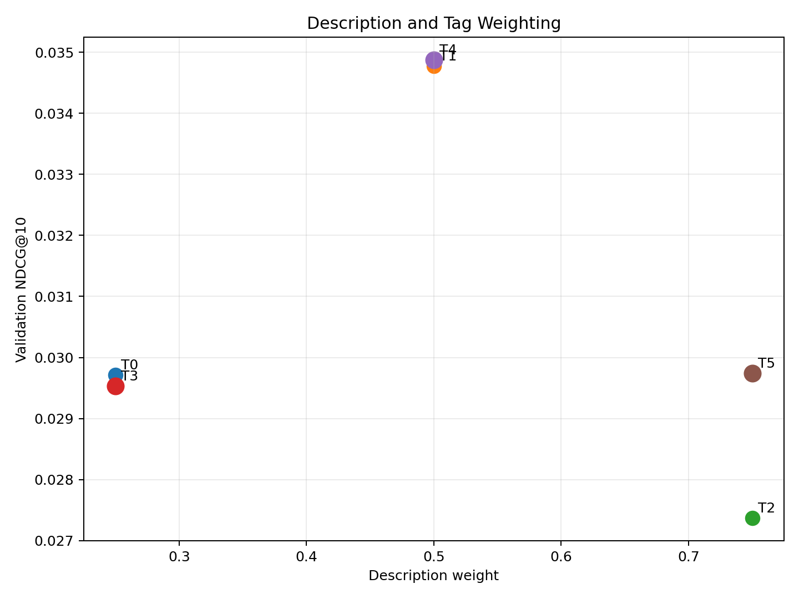
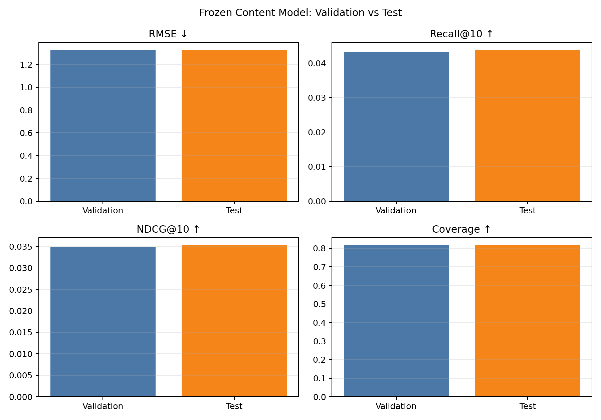

# 콘텐츠 기반 추천 실험 보고서

## 1. 실험 목적

사용자의 학습 평점 이력에서 좋아한 게임의 내용 특징을 모아 취향 프로필을
만들고, 설명·카테고리·메커니즘이 가까운 미평가 게임을 추천한다. 다른
모델과 동일한 사용자 20,000명, 게임 2,000개와 평가 지표를 사용했다.

## 2. 특징 구성

게임 특징은 다음 두 부분으로 구성했다.

- 설명: HTML 표현을 정리하고 영문 단어를 추출한 뒤 TF-IDF로 변환했다.
- 태그: 카테고리와 메커니즘을 서로 다른 접두어의 multi-hot 벡터로 변환했다.

각 부분을 따로 L2 정규화한 뒤 validation에서 선택한 가중치로 결합했다.
사용자가 학습 데이터에서 8점 이상 준 게임에는 `평점 - 8 + 1`의 가중치를
주고, 가중 평균 특징을 다시 정규화해 사용자 취향 벡터로 사용했다. 이미
평가한 게임은 추천 후보에서 제외했다.

## 3. 데이터와 평가 절차

- 사용자: 20,000명
- 게임: 2,000개
- 학습 평점: 1,599,055개
- 검증 평점: 215,504개
- 테스트 평점: 214,663개
- 관련 게임 기준: 평점 8점 이상
- 설정 선택 기준: validation NDCG@10, 이후 Recall@10, RMSE, Coverage

설명 단어 수 2,000/4,000과 설명 가중치 0.25/0.50/0.75의 조합 6개를
validation에서 비교했다. 최종 설정을 고정한 뒤 test는 한 번만 평가했다.

## 4. 최종 설정

| 설정 | 선택값 |
| --- | ---: |
| 설명 TF-IDF 특징 | 4,000개 |
| 카테고리·메커니즘 태그 | 271개 |
| 최소 문서 빈도 | 2 |
| 설명 가중치 | 0.50 |
| 태그 가중치 | 0.50 |
| 좋아한 게임 기준 | 8점 이상 |
| 평점 변환 배율 | 2.0 |

설명이나 태그 한쪽에 치우친 설정보다 두 특징을 같은 비중으로 사용한 설정의
NDCG@10이 가장 높았다. 같은 50:50 가중치에서 4,000개 단어 설정이
2,000개 설정보다 NDCG@10이 조금 높아 최종 설정으로 선택됐다.





## 5. 최종 성능

| 분할 | RMSE ↓ | Recall@10 ↑ | NDCG@10 ↑ | Coverage ↑ |
| --- | ---: | ---: | ---: | ---: |
| Validation | 1.3291 | 0.0431 | 0.0349 | 0.8155 |
| Test | 1.3258 | 0.0438 | 0.0352 | 0.8155 |

test에서 모든 지표가 validation과 비슷하거나 소폭 개선됐다. 콘텐츠 모델은
ItemCF보다 Recall과 NDCG가 낮지만 Matrix Factorization보다 높았고,
Coverage도 81.6%로 넓은 추천 범위를 유지했다.



## 6. 콘텐츠 점수 파일

전체 사용자·게임 조합은 4천만 행이므로 전달 파일에는 각 사용자가 아직
평가하지 않은 게임 중 상위 100개만 저장했다.

- 경로: `data/experiment/content_scores.csv`
- 행 수: 헤더 제외 2,000,000개
- 열: `user_id`, `item_id`, `rank`, `content_score`
- 점수: 사용자 취향 벡터와 게임 특징 벡터의 코사인 유사도

원하는 후보 수가 달라지면 `--export-top-k`로 조정할 수 있으며, 모델은 전체
2,000개 게임을 점수화한 뒤 상위 항목만 파일로 내보낸다.

## 7. 재현 방법과 산출물

```bash
.venv/bin/python -m src.experiments.content_based_experiment --mode tune
.venv/bin/python -m src.experiments.content_based_experiment --mode final
```

- `content_trials.csv`: 여섯 validation 설정과 지표
- `best_content.json`: validation에서 선택한 설정
- `final_test_metrics.json`: 고정 설정의 최종 test 결과
- `ranking_metrics.png`: 설정별 Recall, NDCG, Coverage
- `feature_weight_effects.png`: 설명/태그 가중치와 NDCG 관계
- `validation_vs_test.png`: validation과 test 비교
