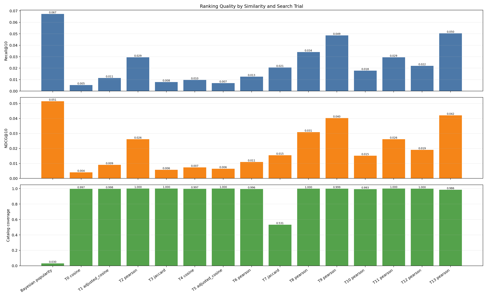
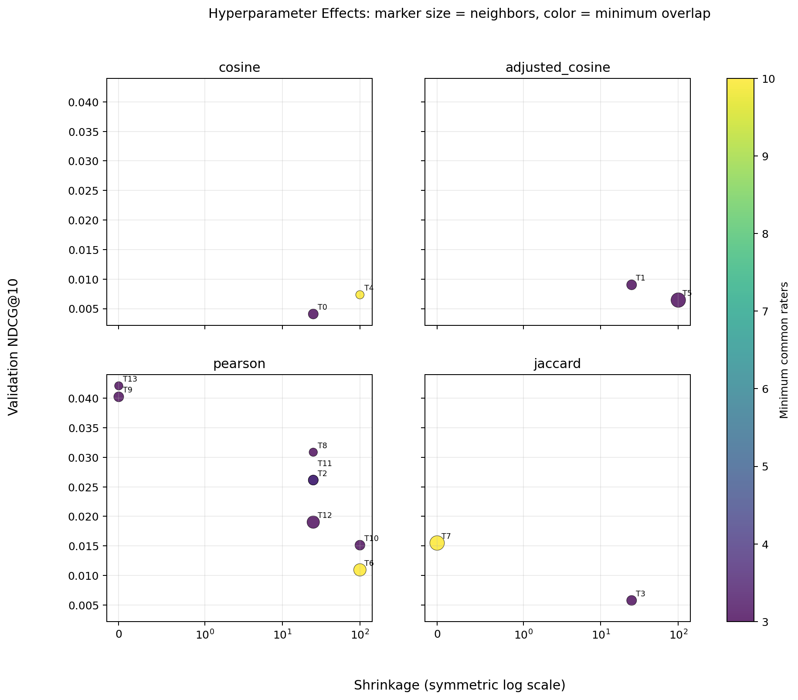
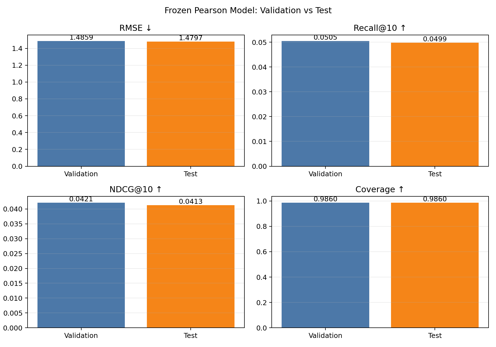

# ItemCF experiment

We compared cosine, adjusted cosine, Pearson and Jaccard similarities. The model uses training ratings to find games with similar rating patterns. Validation NDCG@10 is the main selection metric, followed by Recall@10 and catalog coverage for ties.

The experiment has 20,000 users and 2,000 games. It contains 1,599,055 training ratings, 215,504 validation ratings and 214,663 test ratings. Ratings of at least 8 count as relevant. Training-rated games are excluded from recommendations.

## Search results

The search tested eight seeded random configurations and six local refinements. The selected settings were Pearson, 20 neighbors, minimum overlap 3, shrinkage 0, minimum similarity 0 and baseline-residual scoring.

| Validation model | RMSE | Recall@10 | NDCG@10 | Coverage |
| --- | ---: | ---: | ---: | ---: |
| Bayesian popularity | 1.3892 | 0.0673 | 0.0515 | 0.0300 |
| Selected ItemCF | 1.4859 | 0.0505 | 0.0421 | 0.9860 |

The Bayesian control had higher ranking scores. ItemCF recommended a wider set of games across users.

## Final test

| Split | RMSE | Recall@10 | NDCG@10 | Coverage |
| --- | ---: | ---: | ---: | ---: |
| Validation | 1.4859 | 0.0505 | 0.0421 | 0.9860 |
| Test | 1.4797 | 0.0499 | 0.0413 | 0.9860 |

The test values were close to the validation values on this split. Test results were calculated after the settings were selected.

## Files and commands

    .venv/bin/python -m src.experiments.item_cf_experiment
    .venv/bin/python -m src.experiments.final_item_cf_test

- item_cf_trials.csv lists the tested settings and validation metrics.
- best_item_cf.json stores the selected settings.
- final_test_metrics.json stores the final test measurements.
- summary.md and final_test_summary.md summarize the saved measurements.
- ranking_metrics.png, rmse_vs_ndcg.png and search_trials.png show validation results.
- hyperparameter_effects.png shows the parameter comparisons.
- validation_vs_test.png compares the selected model on both splits.
