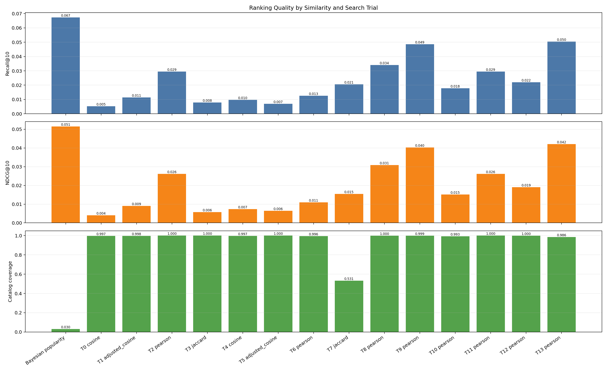
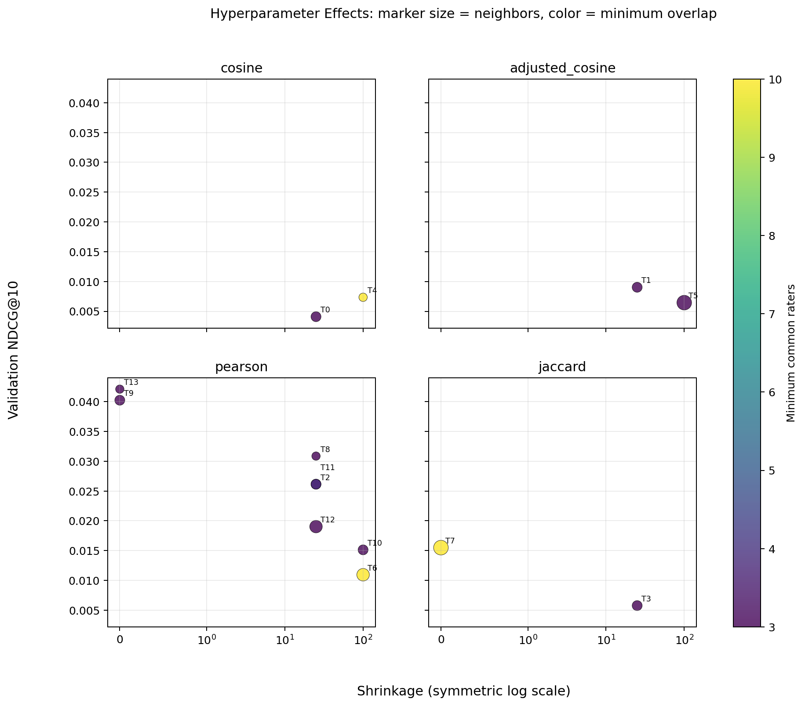
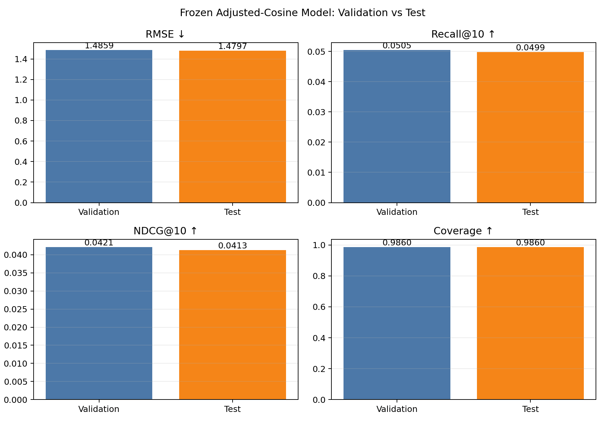

# ItemCF 실험 보고서

## 1. 실험 목적

사용자가 높게 평가한 게임과 평점 패턴이 비슷한 게임을 찾아 개인별 Top 10을
추천한다. 단순 평점 예측 정확도뿐 아니라 실제 추천 순위 품질을 확인하기 위해
RMSE, Recall@10, NDCG@10, Coverage를 함께 측정했다.

## 2. 데이터와 평가 절차

- 사용자: 20,000명
- 게임: 2,000개
- 학습 평점: 1,599,055개
- 검증 평점: 215,504개
- 테스트 평점: 214,663개
- 관련 게임 기준: 평점 8점 이상
- 추천 후보: 사용자가 학습 데이터에서 평가하지 않은 게임
- 설정 선택 기준: validation NDCG@10, 동률이면 Recall@10과 Coverage

학습 데이터로 모델을 만들고 validation에서 설정을 선택했다. 선택된 설정을
고정한 뒤 test를 한 번만 평가했으며, test 결과로 설정을 변경하지 않았다.

## 3. 비교한 방법

아이템 사이의 유사도를 네 방식으로 계산했다.

- Cosine: 두 게임의 사용자 평점 벡터 방향을 비교한다.
- Adjusted cosine: 사용자별 평균 평점을 제거해 후한 사용자와 엄격한 사용자의
  평점 성향을 보정한다.
- Pearson: 두 게임을 함께 평가한 사용자의 평점 변화 패턴을 비교한다.
- Jaccard: 일정 점수 이상을 준 사용자 집합의 겹침을 비교한다.

공통 평가자가 적은 유사도를 완화하는 shrinkage, 최소 공통 평가자 수,
이웃 개수, 최소 유사도와 점수 결합 방식을 함께 탐색했다. 대조군은 학습
평점만 이용한 Bayesian popularity이다.

## 4. 검증 실험

8개 random-search 설정을 비교한 뒤 가장 좋은 계열 주변에서 6개 local-grid
설정을 추가로 확인했다. 최종 ItemCF 설정은 다음과 같다.

| 설정 | 선택값 |
| --- | ---: |
| 유사도 | Pearson |
| 이웃 수 | 20 |
| 최소 공통 평가자 | 3 |
| Shrinkage | 0 |
| 최소 유사도 | 0 |
| 점수 결합 | Baseline residual |

| 모델 | RMSE ↓ | Recall@10 ↑ | NDCG@10 ↑ | Coverage ↑ |
| --- | ---: | ---: | ---: | ---: |
| Bayesian popularity | 1.3892 | **0.0673** | **0.0515** | 0.0300 |
| 최종 ItemCF | 1.4859 | 0.0505 | 0.0421 | **0.9860** |

Bayesian popularity가 검증 Recall과 NDCG는 더 높았지만 추천 게임이 전체
카탈로그의 3%에 집중됐다. ItemCF는 추천 순위 지표가 조금 낮은 대신 게임의
98.6%를 추천 목록에 노출해 개인별 추천 범위가 훨씬 넓었다.





## 5. 최종 테스트

| 분할 | RMSE ↓ | Recall@10 ↑ | NDCG@10 ↑ | Coverage ↑ |
| --- | ---: | ---: | ---: | ---: |
| Validation | 1.4859 | 0.0505 | 0.0421 | 0.9860 |
| Test | 1.4797 | 0.0499 | 0.0413 | 0.9860 |

테스트에서 RMSE는 소폭 개선됐고 Recall과 NDCG는 소폭 감소했다. 네 지표의
차이가 작아 validation에서 선택한 설정이 test에서도 비슷하게 동작했다.



## 6. 재현 방법과 산출물

```bash
.venv/bin/python -m src.experiments.item_cf_experiment
.venv/bin/python -m src.experiments.final_item_cf_test
```

- `item_cf_trials.csv`: 전체 탐색 설정과 validation 지표
- `best_item_cf.json`: validation에서 선택된 설정
- `final_test_metrics.json`: 고정 설정의 최종 test 결과
- `summary.md`, `final_test_summary.md`: 자동 생성 요약
- `ranking_metrics.png`, `rmse_vs_ndcg.png`, `search_trials.png`:
  validation 비교 그래프
- `hyperparameter_effects.png`: 설정 변화에 따른 NDCG 변화
- `validation_vs_test.png`: validation과 test 비교
