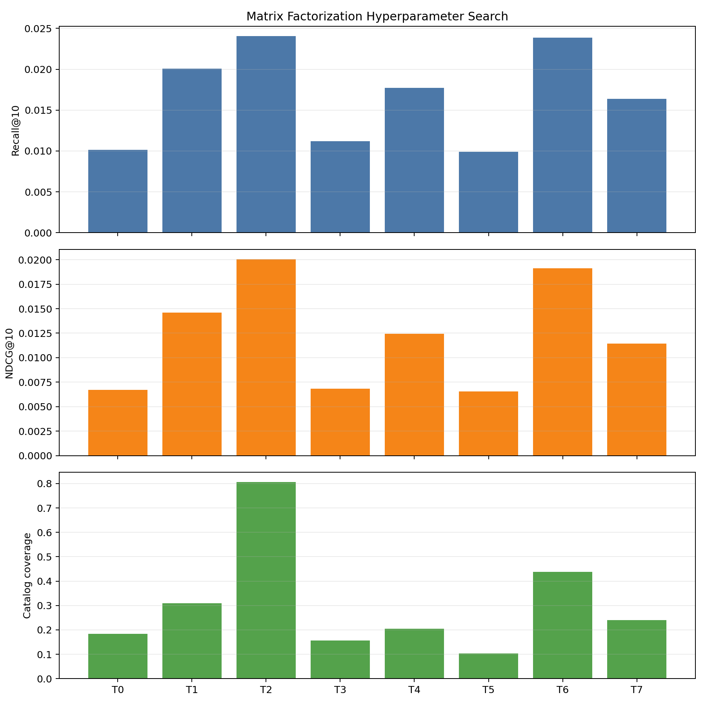
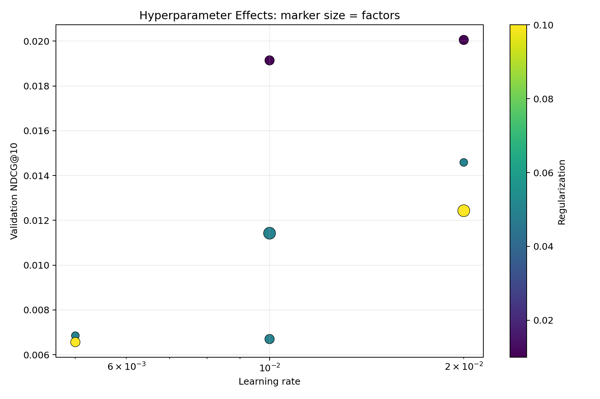
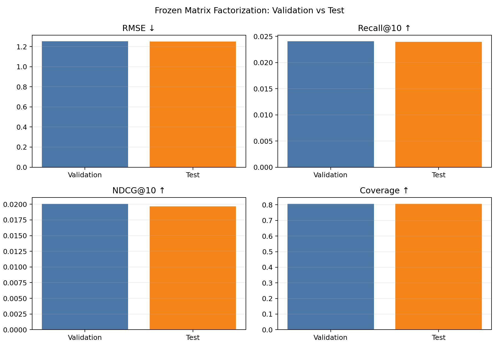

# Matrix Factorization 실험 보고서

## 1. 실험 목적

사용자와 게임을 같은 잠재요인 공간의 벡터로 표현하고, 두 벡터의 내적과
사용자·게임 편향으로 평점을 예측한다. 잠재요인 수, 학습률, 정규화 강도와
학습 epoch를 조정해 개인별 Top 10 추천 품질을 비교했다.

## 2. 데이터와 평가 절차

- 사용자: 20,000명
- 게임: 2,000개
- 학습 평점: 1,599,055개
- 검증 평점: 215,504개
- 테스트 평점: 214,663개
- 관련 게임 기준: 평점 8점 이상
- 추천 후보: 사용자가 학습 데이터에서 평가하지 않은 게임
- 설정 선택 기준: validation NDCG@10, 동률이면 Recall@10, RMSE, Coverage

모든 설정은 같은 train과 validation에서 비교했다. 최종 설정을 고정한 뒤
test를 한 번만 평가했으며, test 결과는 설정 선택에 사용하지 않았다.

## 3. 모델과 탐색 범위

예측 평점은 전역 평균, 사용자 편향, 게임 편향과 사용자·게임 잠재 벡터의
내적으로 계산한다. 학습 평점의 제곱 오차와 L2 정규화 항을 확률적
경사하강법으로 최소화했다.

8개의 결정적 random-search 설정에서 다음 값을 비교했다.

- 잠재요인: 16, 32, 64
- 학습률: 0.005, 0.01, 0.02
- 정규화: 0.01, 0.05, 0.10
- Epoch: 8, 12, 18
- Batch size: 4,096
- Seed: 42

## 4. 최종 설정

| 설정 | 선택값 |
| --- | ---: |
| 잠재요인 | 32 |
| 학습률 | 0.02 |
| 정규화 | 0.01 |
| Epoch | 18 |
| Batch size | 4,096 |
| 최종 학습 RMSE | 0.8280 |

이 설정은 validation NDCG@10이 가장 높았다. 학습 RMSE가 validation RMSE보다
낮지만 정규화와 별도의 validation 선택을 사용해 test를 직접 튜닝하지 않았다.





## 5. 최종 성능

| 분할 | RMSE ↓ | Recall@10 ↑ | NDCG@10 ↑ | Coverage ↑ |
| --- | ---: | ---: | ---: | ---: |
| Validation | 1.2518 | 0.0240 | 0.0201 | 0.8060 |
| Test | 1.2512 | 0.0239 | 0.0197 | 0.8060 |

validation과 test의 지표가 거의 동일해 선택된 설정의 성능이 안정적으로
유지됐다. ItemCF보다 RMSE는 낮아 평점 예측이 정확했지만 Recall@10과
NDCG@10은 낮았다. 반면 Coverage 0.806으로 넓은 게임 범위를 추천했다.



## 6. 재현 방법과 산출물

```bash
.venv/bin/python -m src.experiments.matrix_factorization_experiment
.venv/bin/python -m src.experiments.final_matrix_factorization_test
```

- `mf_trials.csv`: 전체 탐색 설정과 validation 지표
- `best_mf.json`: validation에서 선택된 설정
- `final_test_metrics.json`: 고정 설정의 최종 test 결과
- `ranking_metrics.png`: 설정별 Recall, NDCG, Coverage
- `rmse_vs_ndcg.png`: 평점 예측 오차와 순위 품질 관계
- `hyperparameter_effects.png`: 잠재요인·학습률·정규화·epoch 영향
- `validation_vs_test.png`: validation과 test 비교
