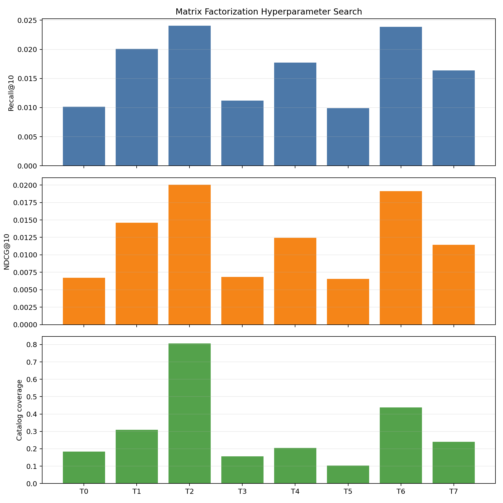
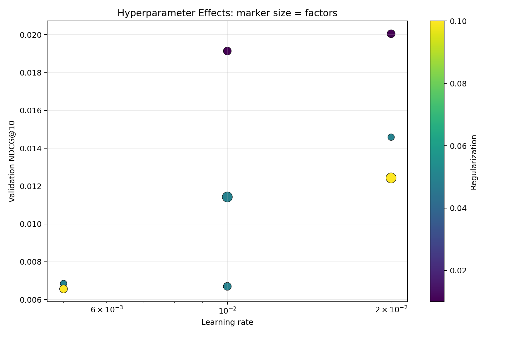
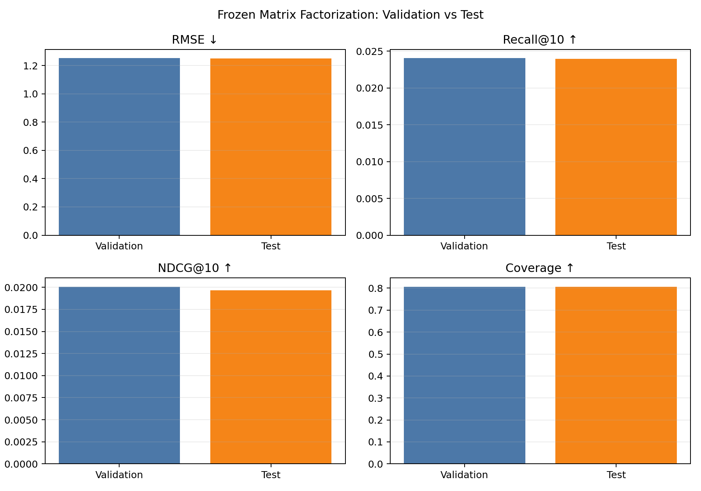

# Matrix factorization experiment

The model predicts a rating from the global mean, user bias, game bias and a dot product of user/game factor vectors. Training uses the observed ratings and regularized mini-batch updates.

The experiment uses the same 20,000 users, 2,000 games and splits as the other models. Settings were selected by validation NDCG@10, then Recall@10 and RMSE for ties.

## Search and selected settings

Eight seeded configurations tested factor counts of 16, 32 or 64, learning rates of 0.005, 0.01 or 0.02, regularization of 0.01, 0.05 or 0.10, and 8, 12 or 18 epochs. Batch size was 4,096 and seed was 42.

| Parameter | Selected value |
| --- | ---: |
| Factors | 32 |
| Learning rate | 0.02 |
| Regularization | 0.01 |
| Epochs | 18 |
| Batch size | 4,096 |

## Final test

| Split | RMSE | Recall@10 | NDCG@10 | Coverage |
| --- | ---: | ---: | ---: | ---: |
| Validation | 1.2518 | 0.0240 | 0.0201 | 0.8060 |
| Test | 1.2512 | 0.0239 | 0.0197 | 0.8060 |

The model had lower rating error than ItemCF, but lower Recall@10 and NDCG@10. The validation and test values were similar on this split.

## Files and commands

    .venv/bin/python -m src.experiments.matrix_factorization_experiment
    .venv/bin/python -m src.experiments.final_matrix_factorization_test

- mf_trials.csv lists the tested settings and validation metrics.
- best_mf.json stores the selected settings.
- final_test_metrics.json stores the final test measurements.
- ranking_metrics.png shows the search results.
- rmse_vs_ndcg.png compares rating error and ranking scores.
- hyperparameter_effects.png shows the parameter comparisons.
- validation_vs_test.png compares both splits.
